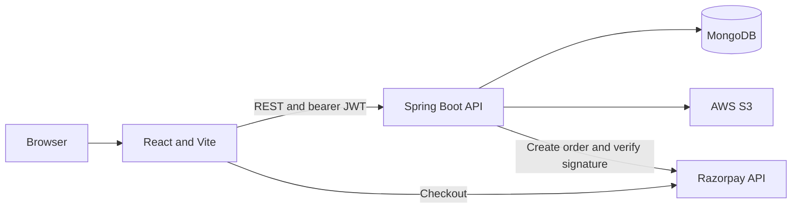

# Happy-Plates

A food ordering application with a React frontend and Spring Boot API for food listings, carts, accounts, and order management.


## Features

- Browse food listings by category and view item details.
- Register and authenticate with JWT.
- Maintain a user-specific cart.
- Place orders and view order history.
- Accept payments through Razorpay Checkout in test mode.
- Manage food listings and order status through admin-only API endpoints.
- Upload food images to AWS S3.

## Tech Stack

| Area | Technology |
| --- | --- |
| Backend | Java 17, Spring Boot 3.5.16, Spring Web, Spring Data MongoDB, Spring Security, Lombok |
| Frontend | React 19.2.3, React Router 7.18.4, Vite 7.2.5, Axios 1.20.0, Bootstrap 5.3.8, Bootstrap Icons 1.13.1, React Toastify 11.0.5 |
| Database | MongoDB |
| Security | Spring Security, JJWT 0.11.5, BCrypt |
| Integrations | AWS SDK for Java 2.31.54 (S3), Razorpay Java SDK 1.4.8 |

## Architecture

The React client calls the Spring Boot REST API. The API stores users, foods, carts, and orders in MongoDB, stores food images in AWS S3, and creates and verifies Razorpay orders. JWT bearer tokens authenticate protected requests.



## Project Structure

```text
Happy-Plates/
|-- foodies/                         React and Vite frontend
|   |-- .env.example                 Frontend environment variable names
|   |-- package.json                 Frontend scripts and dependencies
|   `-- src/
|       |-- assets/                  Images and UI assets
|       |-- components/              Shared interface components
|       |-- context/                 Shared application state
|       |-- pages/                   Route-level screens
|       |-- service/                 Backend API clients
|       `-- util/                    Cart and configuration utilities
`-- foodiesapi/                      Spring Boot REST API
    |-- mvnw, mvnw.cmd               Maven Wrapper launchers
    |-- pom.xml                      Backend dependencies and build
    `-- src/main/
        |-- java/
        |   `-- com/foodify/foodiesapi/
        |       |-- config/          AWS and security configuration
        |       |-- controller/      REST endpoints
        |       |-- entity/          MongoDB documents
        |       |-- enums/           User roles and order statuses
        |       |-- exception/       API exception handling
        |       |-- filters/         JWT request filter
        |       |-- io/              API request and response models
        |       |-- repository/      MongoDB repositories
        |       |-- service/         Application business logic
        |       `-- util/            JWT utilities
        `-- resources/                Application configuration
```

## Prerequisites

- JDK 17
- Node.js 20.19+ or 22.12+ and npm (required by Vite 7.2.5)
- MongoDB
- AWS credentials and an S3 bucket for food image uploads
- Razorpay test-mode API credentials for checkout

## Getting Started

### Clone

```bash
git clone https://github.com/Pratham-131/happy-plates-food-ordering.git
cd happy-plates-food-ordering
```

### Configure and Run the Backend

Copy the example properties file, then set the MongoDB, JWT, AWS, and Razorpay values:

```bash
cd foodiesapi
cp src/main/resources/application.properties.example src/main/resources/application.properties
```

Set the values in `src/main/resources/application.properties` using your own credentials. Do not commit real secrets.

| Property | Purpose | Value |
| --- | --- | --- |
| `server.port` | Backend HTTP port | `8080` |
| `spring.data.mongodb.uri` | MongoDB connection | `mongodb://localhost:27017/happyplates` |
| `jwt.secret.key` | JWT signing key | `<long random signing secret>` |
| `aws.access.key` | AWS access key | `<AWS access key>` |
| `aws.secret.key` | AWS secret key | `<AWS secret key>` |
| `aws.region` | S3 bucket region | `ap-south-1` (example) |
| `aws.s3.bucketname` | Food image bucket | `<S3 bucket name>` |
| `razorpay.key.id` | Razorpay test key ID | `<Razorpay test key ID>` |
| `razorpay.key.secret` | Razorpay test key secret | `<Razorpay test key secret>` |

The API port defaults to `8080`. Keep the Razorpay secret and other credentials on the backend only.

```bash
./mvnw spring-boot:run
```

```powershell
.\mvnw spring-boot:run
```

### Run the Frontend

In another terminal:

```bash
cd foodies
cp .env.example .env
npm install
npm run dev
```

Vite serves the frontend at `http://localhost:5173`. `VITE_API_URL` defaults to `http://localhost:8080/api` and can be changed in `.env`.

| Variable | Purpose | Value |
| --- | --- | --- |
| `VITE_API_URL` | Backend API base URL | `http://localhost:8080/api` |
| `VITE_RAZORPAY_KEY` | Razorpay test-mode public key ID | `<Razorpay test key ID>` |

### Create an ADMIN Account

Register an account normally, then promote its document in the `happyplates` MongoDB database. Public registration always creates a `USER` role.

```javascript
use("happyplates")

db.users.updateOne(
    { email: "<registered-admin-email>" },
    { $set: { role: "ADMIN" } }
)
```

Run the update in `mongosh` connected to the database configured by `spring.data.mongodb.uri`.

## API

Paths include the `/api` prefix. `Authenticated` requires a valid bearer token; `ADMIN` requires the administrator role.

| Method | Path | Description | Auth / role |
| --- | --- | --- | --- |
| `POST` | `/api/register` | Register a regular user | Public |
| `POST` | `/api/login` | Log in as a regular user | Public |
| `POST` | `/api/admin/login` | Log in as an administrator | Public; ADMIN account required |
| `GET` | `/api/foods` | List food items | Public |
| `GET` | `/api/foods/{id}` | Read a food item | Public |
| `POST` | `/api/foods` | Create a food item and upload its image | ADMIN |
| `DELETE` | `/api/foods/{id}` | Delete a food item | ADMIN |
| `GET` | `/api/cart` | Read the current user's cart | Authenticated |
| `POST` | `/api/cart` | Add an item to the cart | Authenticated |
| `POST` | `/api/cart/remove` | Decrement an item quantity | Authenticated |
| `DELETE` | `/api/cart` | Clear the current user's cart | Authenticated |
| `GET` | `/api/orders` | List the current user's orders | Authenticated |
| `POST` | `/api/orders/create` | Create an order and Razorpay payment order | Authenticated |
| `POST` | `/api/orders/verify` | Verify Razorpay payment signature | Authenticated |
| `DELETE` | `/api/orders/{orderId}` | Delete the current user's pending order | Authenticated |
| `GET` | `/api/orders/all` | List all orders | ADMIN |
| `PATCH` | `/api/orders/status/{orderId}?status=CONFIRMED` | Update order status | ADMIN |

Order statuses are `PLACED`, `CONFIRMED`, `DELIVERED`, and `CANCELLED`.

## Add Food Items

There is no food-entry page in the frontend. Sign in with an ADMIN account to `POST /api/admin/login`, then use the returned `token` as a bearer token to submit the food JSON and image as multipart parts:

```bash
curl -X POST http://localhost:8080/api/admin/login \
    -H "Content-Type: application/json" \
    -d '{"email":"<admin-email>","password":"<admin-password>"}'

curl -X POST http://localhost:8080/api/foods \
    -H "Authorization: Bearer <token>" \
    -F 'food={"name":"<name>","description":"<description>","price":0,"category":"<category>"};type=application/json' \
    -F 'file=@<file-path>'
```

Use Postman or Git Bash for these commands. PowerShell breaks the JSON quoting.

## Authentication

Registration always creates a `USER` account. `/api/login` is for regular users; `/api/admin/login` accepts only an account with the `ADMIN` role. Successful login returns a signed HS256 JWT with the email subject and role claim; tokens expire after 10 hours. Send the token as `Authorization: Bearer <token>`. Passwords are stored with BCrypt, and the API is stateless.

## Payment

Checkout sends food IDs and quantities to the API. The backend reads current food prices from MongoDB, adds 10% tax and INR 10 shipping for non-empty orders, and creates the Razorpay order. Razorpay Checkout runs in test mode with `VITE_RAZORPAY_KEY`; the backend verifies the payment signature with its secret before marking the order `PAID`. Use Razorpay test credentials for local payments.

## Future Improvements

- Add an admin dashboard for food and order management.
- Add pagination and search to food and order listings.
- Add cleanup for stale pending orders.
- Share fee rules between the frontend and backend.
- Add tests and CI.
- Add Docker support.

## Author

Pratham Saxena

GitHub: https://github.com/Pratham-131
LinkedIn: https://www.linkedin.com/in/pratham-saxena-095373231

Contributors: [raufurkhan](https://github.com/raufurkhan) and [nakadeuttam](https://github.com/nakadeuttam) (team members); Pratham Saxena: JWT and role security, order flow, Razorpay payment, and API docs.
