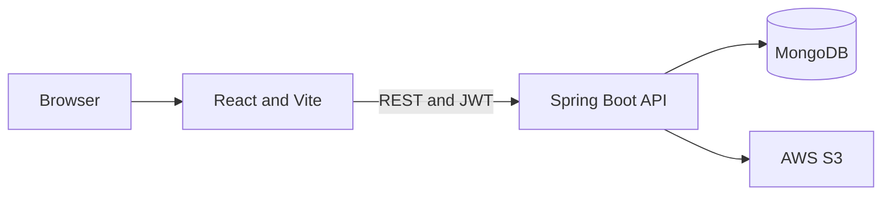

# Happy-Plates

A food ordering application with a React frontend and Spring Boot API for food listings, carts, accounts, and order management.


## Features

- Browse food listings and item details.
- Register and authenticate with JWT.
- Maintain a user-specific cart.
- Place orders and view order history.
- Accept payments through Razorpay Checkout in test mode.
- Manage food listings and order status with an admin account.
- Upload food images to AWS S3.

## Tech Stack

| Area | Technology |
| --- | --- |
| Backend | Java 17, Spring Boot 3.5.16, Spring Web, Spring Data MongoDB |
| Frontend | React 19.2.3, Vite 7.2.5, React Router, Axios, Bootstrap |
| Database | MongoDB |
| Security | Spring Security, JWT (JJWT), BCrypt |
| Cloud | AWS S3 |

## Architecture

The React client calls the Spring Boot REST API. The API stores users, foods, carts, and orders in MongoDB and stores food images in AWS S3. JWT bearer tokens authenticate protected requests.



## Project Structure

```text
Happy-Plates/
|-- foodies/
|   |-- src/assets/       Frontend assets
|   |-- src/components/   Shared UI components
|   |-- src/context/      Shared application state
|   |-- src/pages/        Route screens
|   |-- src/service/      API clients
|   `-- src/util/         Frontend utilities
`-- foodiesapi/
    |-- src/main/java/com/foodify/foodiesapi/
    |   |-- config/      AWS and security configuration
    |   |-- controller/  REST controllers
    |   |-- entity/      MongoDB documents
    |   |-- enums/       Role and order status values
    |   |-- filters/     JWT request filter
    |   |-- io/          API request and response models
    |   |-- repository/  MongoDB repositories
    |   |-- service/     Business logic
    |   `-- util/        JWT utilities
    `-- src/main/resources/ Backend configuration examples
```

## Prerequisites

- JDK 17
- Maven Wrapper (included), or Maven 3.6.3 or newer
- Node.js 20.19+ or 22.12+ and npm (required by Vite 7.2.5)
- MongoDB
- AWS credentials and an S3 bucket for food image uploads

## Getting Started

### Clone

```bash
git clone https://github.com/<your-username>/Happy-Plates.git
cd Happy-Plates
```

### Configure and Run the Backend

Copy the example properties file and set your MongoDB, AWS, and Razorpay test credentials:

```bash
cd foodiesapi
cp src/main/resources/application.properties.example src/main/resources/application.properties
```

Set the values in `src/main/resources/application.properties` using your own credentials. Do not commit real secrets.

| Setting | Used by | Value |
| --- | --- | --- |
| `spring.data.mongodb.uri` | Backend | MongoDB connection URI |
| `jwt.secret.key` | Backend | Long random JWT signing secret |
| `aws.access.key`, `aws.secret.key`, `aws.region`, `aws.s3.bucketname` | Backend | AWS S3 access and bucket |
| `razorpay.key.id`, `razorpay.key.secret` | Backend | Razorpay test-mode API credentials |
| `VITE_API_URL` | Frontend `.env` | API base URL, usually `http://localhost:8080/api` |
| `VITE_RAZORPAY_KEY` | Frontend `.env` | Razorpay test-mode public key ID |

The API port defaults to `8080`. Razorpay key IDs are public; keep the key secret on the backend only.

```bash
./mvnw spring-boot:run
```

### Run the Frontend

In another terminal:

```bash
cd foodies
cp .env.example .env
npm install
npm run dev
```

Vite serves the frontend at `http://localhost:5173`. `VITE_API_URL` defaults to `http://localhost:8080/api` and can be changed in `.env`.

## API

Paths are relative to the API base URL. `Authenticated` allows a logged-in user; `ADMIN` requires an administrator role.

| Method | Path | Description | Auth / role |
| --- | --- | --- | --- |
| `POST` | `/api/register` | Register a regular user | Public |
| `POST` | `/api/login` | Log in as a regular user | Public |
| `POST` | `/api/admin/login` | Log in as an administrator | Public; ADMIN account required |
| `GET` | `/api/foods` | List food items | Public |
| `GET` | `/api/foods/{id}` | Read a food item | Public |
| `POST` | `/api/foods` | Create a food item with image | ADMIN |
| `DELETE` | `/api/foods/{id}` | Delete a food item | ADMIN |
| `GET` | `/api/cart` | Read the current user's cart | Authenticated |
| `POST` | `/api/cart` | Add an item to the cart | Authenticated |
| `POST` | `/api/cart/remove` | Decrement an item quantity | Authenticated |
| `DELETE` | `/api/cart` | Clear the current user's cart | Authenticated |
| `GET` | `/api/orders` | List the current user's orders | Authenticated |
| `POST` | `/api/orders/create` | Place an order | Authenticated |
| `POST` | `/api/orders/verify` | Verify Razorpay payment signature | Authenticated |
| `DELETE` | `/api/orders/{orderId}` | Delete the current user's order | Authenticated |
| `GET` | `/api/orders/all` | List all orders | ADMIN |
| `PATCH` | `/api/orders/status/{orderId}?status=CONFIRMED` | Update order status | ADMIN |

Order statuses are `PLACED`, `CONFIRMED`, `DELIVERED`, and `CANCELLED`. Checkout creates a Razorpay order in INR; the backend calculates the amount from MongoDB food prices and changes payment status from `PENDING` to `PAID` only after verifying Razorpay's signature. Use Razorpay test credentials for local testing.

## Authentication

Registration always creates a `USER` account. Login returns a signed HS256 JWT with the email subject and role claim; tokens expire after 10 hours. Send the token as `Authorization: Bearer <token>`. Passwords are stored with BCrypt. Admin accounts must be provisioned outside public registration.

## Screenshots

<!-- Add screenshots at these paths. -->


## Future Improvements

- Add role-based dashboards.
- Add pagination and search.

## Author

Pratham Saxena  
GitHub: <your-link>  
LinkedIn: <your-link>